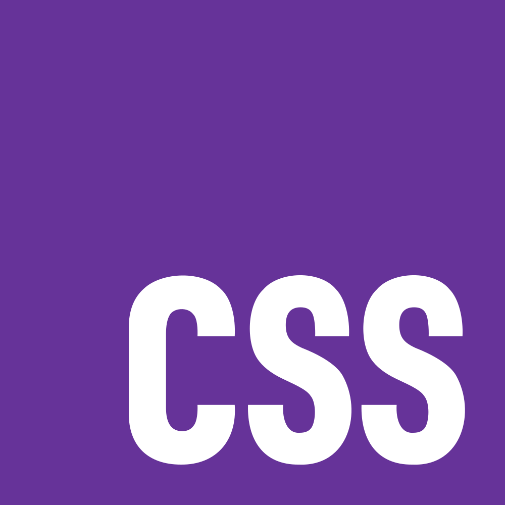

# The stack

-  **HTML** Plain HTML, server-side rendered
-  **CSS** Plain .CSS files for styling
- 🚀 **Rocket** Simple web component for when JavaScript is needed
-  **Go** Backend
-  **templ** HTML templating language
-  **Datastar** Live updates
-  **SQLite** Storing state

HTML5 logo by W3C, CC BY 3.0. SQLite is a registered trademark of Hipp, Wyrick &amp; Company, Inc.

Notes:

- Keep this short: context, not a sales pitch.
- JavaScript is rarely needed. Prefer server-side rendering. You will see.
