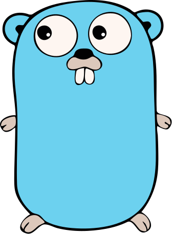

# The stack

- 📄 **HTML** Plain HTML, server-side rendered
- 🎨 **CSS** Plain .CSS files for styling
- 🚀 **Rocket** Simple web component for when JavaScript is needed
-  **Go** Backend
- 🧩 **templ** HTML templating language
- 📡 **Datastar** Live updates
- 🗄️ **SQLite** Storing state

Go gopher by Renée French, CC BY 4.0

Notes:

- Keep this short: context, not a sales pitch.
- JavaScript is rarely needed. Prefer server-side rendering. You will see.
